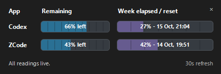

# UsageFairy

UsageFairy shows **weekly allowance remaining** on the existing Windows taskbar icons for Codex, Claude, and ZCode. It adds a small number to each open app's icon, without adding new taskbar icons.

Click the `%` notification area icon for a compact details window. It shows only apps that are open, with segmented bars for allowance remaining and days elapsed in the current week. Drag its top row to move it; UsageFairy remembers the position. The X hides the window while the badges keep running.

## Install

Requires Windows 10/11, Windows PowerShell 5.1, and Node.js 18 or newer on `PATH`. Install and sign in to the apps whose usage you want to see.

1. Clone this repository to a folder you intend to keep.
2. Run `powershell.exe -NoProfile -ExecutionPolicy Bypass -File .\Install-Startup.ps1` from that folder. This creates a `UsageFairy.lnk` shortcut in your Windows Startup folder, so it launches after sign-in.
3. Start it now with `powershell.exe -NoProfile -Sta -ExecutionPolicy Bypass -WindowStyle Hidden -File .\TaskbarAllowances.ps1`. At the next sign-in it starts automatically.

Run the installer again after moving the folder to update the shortcut. To disable autostart, remove `UsageFairy.lnk` from `%APPDATA%\Microsoft\Windows\Start Menu\Programs\Startup`. Right-click the `%` tray icon and choose **Exit widget** to stop the current session.

## Readings

| App | Source |
| --- | --- |
| Codex | Local Codex `app-server` rate limit read. |
| Claude | Windows accessibility reading of the Claude Desktop Usage view or prompt popover. When Claude is focused and Windows has been idle for 15 seconds, UsageFairy may briefly open and close the popover; automatic peeks are at most once per 15 minutes. It makes no direct Claude usage API calls. |
| ZCode | Read-only Coding Plan usage endpoint using the locally installed ZCode credential. |

The poller refreshes every 30 seconds. Percentages are **remaining**, so a provider's 7% used appears as 93% here. A cached Claude reading has a small orange dot; the details window notes cached or unavailable readings at the bottom. When a current value cannot be read, the badge shows `--`. Reset times appear in the week bars when available.

UsageFairy writes current readings, logs, saved window position, and hourly snapshots under `data/` in its folder. `data/` is ignored by Git. `data/weekly-history.jsonl` records one snapshot per UTC hour while running, including each available remaining percentage, change since the previous hour, and reset time. Unavailable or stale readings are recorded as `null`.

The scripts use local app credentials already present on the computer. They do not copy credentials into `data/`; keep your local ZCode credential file private.
